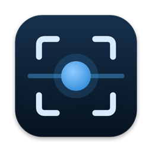
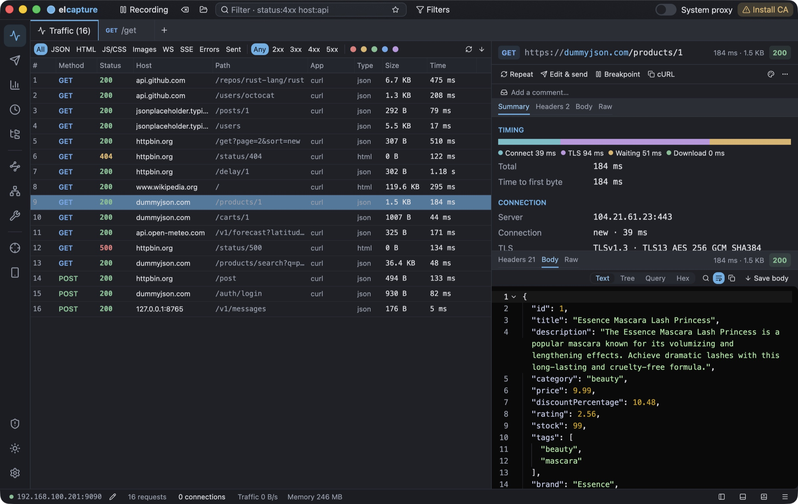
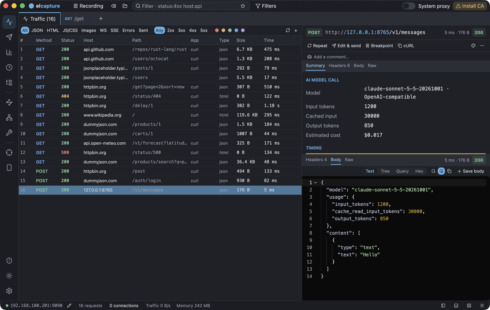
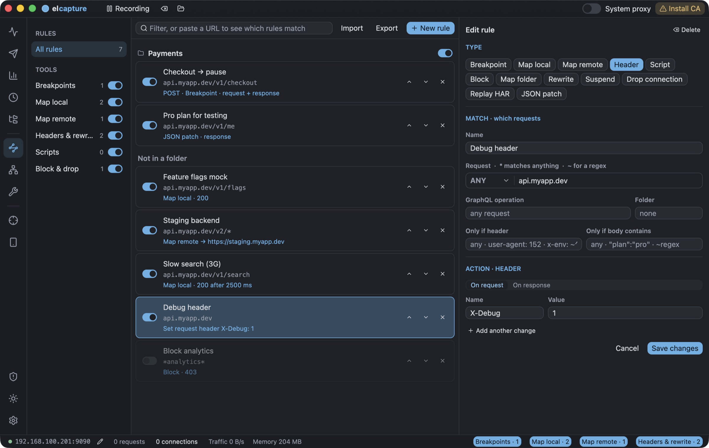

<h1 align="center">elcapture</h1>

A native HTTPS debugging proxy for Mac. 
See every request your apps make — pause it, change it, replay it as a real browser, or answer it yourself.

<a href="https://github.com/elcapture/elcapture/releases/latest/download/elcapture.dmg"><b>Download for Mac</b></a> · <a href="https://elcapture.com">elcapture.com</a> · <a href="https://github.com/elcapture/elcapture/issues/new/choose">Report a bug</a>

This repository is for bug reports, feature requests, questions and release notes. The app's source code isn't published.

## What it does

- **Decrypts HTTPS**, HTTP/2, WebSocket, gRPC and Server-Sent Events from any app on your Mac, a phone on the same Wi-Fi, an emulator or a simulator.
- **Breakpoints**: pause a request or a response, edit it, send it on.
- **Rules**: mock responses (Map Local), redirect hosts (Map Remote), rewrite with regex, apply JSON patches, add or remove headers, block, slow down or drop connections, replay a HAR file offline.
- **Scripts** in JavaScript, Python or Rhai that change requests and responses as they pass.
- **API client** with collections and environments; send any captured request again, edited.
- **Android**: installs its certificate into the system store over adb (Android 14+ included), sets the device proxy and can start frida-server for SSL-pinning bypass. **iOS Simulator**: trusts its certificate in every booted simulator in one click.
- **Spots anti-bot / WAF challenges**: tells you when Cloudflare, DataDome, PerimeterX, Akamai or Imperva blocked a request, right in its summary.
- **Send as a real browser**: replay any request with Chrome, Safari, Firefox or OkHttp's genuine TLS/JA3/JA4 fingerprint to get past anti-bot.
- **AI model calls** to OpenAI, Anthropic and Gemini show the model, token counts and an estimated cost.
- Compare two requests (⌘Y), sessions (⇧⌘N), a fuzzer and a passive security scanner.

No account. Captured traffic stays on your Mac. No limits on rules.

## Install

Requires a Mac with Apple Silicon and macOS 12 or later.

1. [Download elcapture.dmg](https://github.com/elcapture/elcapture/releases/latest/download/elcapture.dmg), open it and drag elcapture into Applications.
2. elcapture is signed and notarized by Apple, so it opens with a normal double-click.
3. In elcapture, click **Install CA**, then turn on **System proxy**.

elcapture checks for new versions at launch and tells you when one is out.

## Feedback

- **Bugs and ideas:** [open an issue](https://github.com/elcapture/elcapture/issues/new/choose). The log helps: menu **elcapture → elcapture log (errors and diagnostics)**.
- **Questions:** [Discussions](https://github.com/elcapture/elcapture/discussions).
- **Security issues:** please don't open a public issue; see [SECURITY.md](SECURITY.md).
- **Anything else:** hello@elcapture.com

## Privacy

elcapture sends nothing anywhere except a check for a newer version (to elcapture.com). History is stored in `~/Library/Application Support/elcapture` and can be encrypted.
